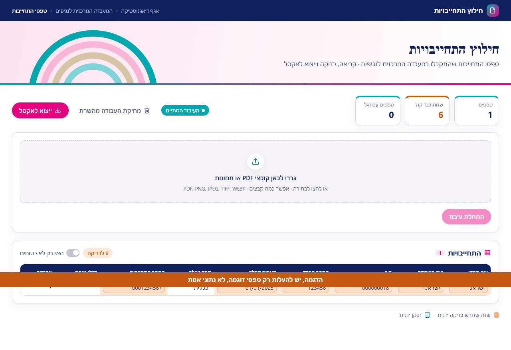
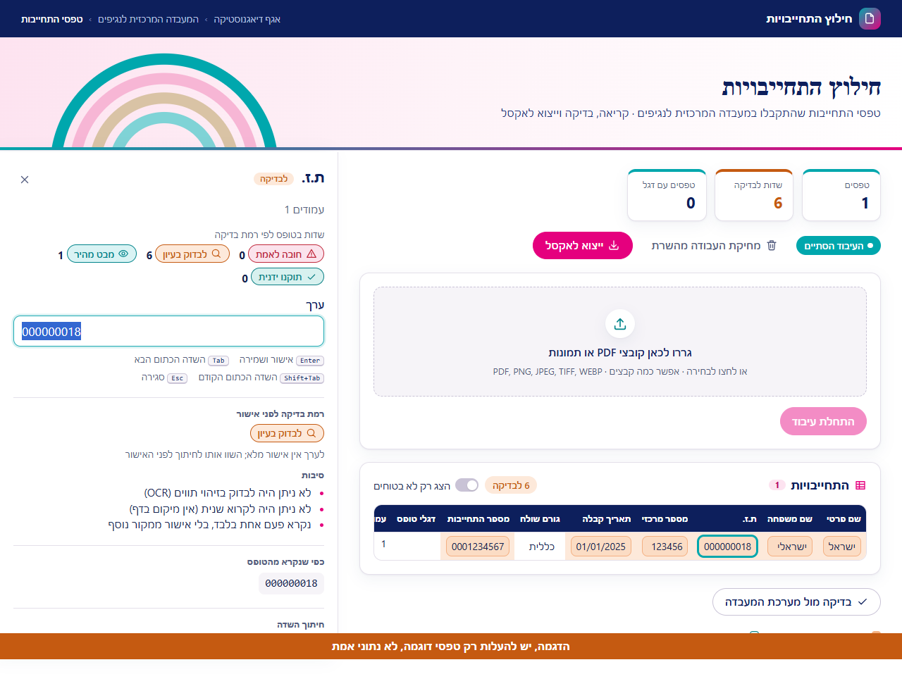
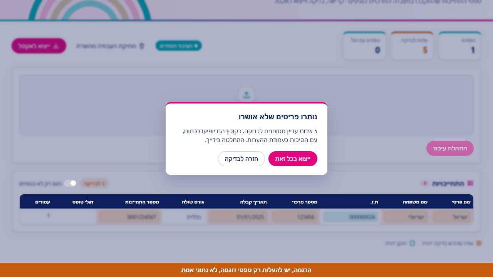
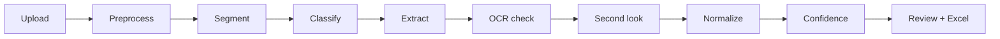

# commitments-extractor

**Turn scanned forms into a clean Excel file — and see exactly which fields still need a human eye.**

Upload a PDF or a photo of scanned forms. The system straightens and cleans every page, splits the pages into individual forms, classifies each one, extracts its fields with a vision-language model, cross-checks the numbers with OCR, and exports an Excel sheet where uncertain values are highlighted with the reason.

🔗 **[Live demo](https://commitments-extractor-lac.vercel.app)**



<p>
  
  
</p>

## ✨ Features
- **PDF and image input** — automatic deskew, perspective and illumination correction, page orientation detection
- **Form segmentation and classification** — splits multi-form scans, recognizes 25 form types, matches the sender against a closed list
- **Pluggable extraction providers** — Claude, Gemini, a local VLM, or a built-in fake provider for running without an API key
- **Double-checking of numbers** — Tesseract OCR cross-check plus a "second look" at values that were not confirmed
- **Normalization and validation** — every value is normalized and flagged if it fails validation
- **Multi-signal confidence score** — each field gets a score; uncertain ones are marked for review
- **Review screen** — table with inline editing, keyboard navigation, and the source image beside the data
- **Excel export** — uncertain cells are highlighted in orange, with the reasons in a dedicated notes column
- **Concurrent processing** — forms are read in parallel; one failed form never stops the others
- **Live progress** — server-sent events stream the job status to the UI

## 🧩 How it works


## 🛠️ Tech stack
| Layer | Technologies |
|---|---|
| Backend | Python 3.11, FastAPI, Pydantic v2, PyMuPDF, OpenCV, Tesseract |
| AI providers | Claude, Gemini, local VLM (swappable through a common interface) |
| Storage | In-memory, SQLite or PostgreSQL (selected by configuration) |
| Frontend | React 19, TypeScript, Vite, TanStack Table |
| Testing | pytest, Vitest, Playwright (end-to-end) |
| Deployment | Docker / Docker Compose, Render (backend), Vercel (frontend) |

## 🏗️ Design highlights
- **One module per pipeline stage**, wired together by a single orchestrator
- **Protocol-based interfaces** for providers, OCR engines and job stores, so each can be swapped without touching the rest
- **Per-form form-type definitions in YAML** — adding a new form type needs no code changes
- **Versioned prompt files** kept separate from the code
- **Bounded concurrency** with a semaphore, retries and timeouts around every provider call

## 🚀 Getting started

**Quickest way — Docker, no API key needed for the demo data:**
```bash
git clone https://github.com/YaffiAdler/commitments-extractor.git
cd commitments-extractor
CE_PROVIDER=fake docker compose up --build
```
Open `http://localhost:5173`.

**Run locally**
```bash
# Backend (Python 3.11, 64-bit; Tesseract 5 with Hebrew data recommended)
py -3.11 -m venv .venv
.venv/Scripts/python -m pip install -c backend/requirements.lock -e "backend[dev]"
cd backend
CE_PROVIDER=fake ../.venv/Scripts/uvicorn app.main:app --reload     # http://localhost:8000

# Frontend
cd frontend
npm ci
npm run dev                                                         # http://localhost:5173
```

To use a real model, set `ANTHROPIC_API_KEY` (Claude) or `CE_PROVIDER=gemini` with `GEMINI_API_KEY`.

**Tests**
```bash
cd backend  && ../.venv/Scripts/python -m pytest
cd frontend && npm test            # unit tests
cd frontend && npm run e2e         # Playwright end-to-end
```

## 📂 Project structure
```
backend/app/pipeline/    one module per stage (ingest → … → confidence)
backend/app/providers/   extraction providers (Claude, Gemini, local VLM, fake)
backend/app/ocr/         OCR engine interface + Tesseract
backend/app/storage/     memory / SQLite / PostgreSQL job stores
backend/form_types/      YAML definition per form type
backend/tests/           pytest suite
frontend/                React + Vite review screen
eval/                    evaluation script and ground-truth data
docs/                    screenshots, deployment guide, design notes
```

## 🗺️ Status and next steps
The full pipeline, review screen and Excel export are working end to end, and the demo is deployed.

## 📚 More documentation
- [Deployment guide](docs/DEPLOY.md)
- [Edge cases](docs/edge_cases.md)
- [Form mapping](docs/form_mapping.md)
